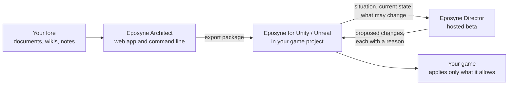

# How Eposyne works

Eposyne makes tools for game narrative. This repository explains, at a high level, how the
products work and how they fit together. It describes what the software does, and it says
plainly what is available today and what is still in development.

- **[Eposyne Architect](architect.md)** is a narrative design environment. It turns lore you
  already have into structured, engine-ready data.
- **[Eposyne Director](director.md)** is a runtime AI game master, in beta. Your game asks it
  what should happen next; Director proposes changes within limits your game declares, and
  your game decides what to apply.
- **[Eposyne for Unity and Eposyne for Unreal](engine-plugins.md)** are the engine plugins
  that connect a game project to both.

## The big picture

Architect is where narrative is written and structured, before the game runs. Director works
while the game runs. The engine plugin sits in between and is the only part that touches
the running game.

## Principles that hold across the products

- **The game has the final say.** Director proposes; it never executes anything. The engine
  checks every proposed change against what the game declared and applies only what is
  allowed.
- **Limits live in the game.** Which values may change, and within which allowed values or
  ranges, is declared by the game itself, not by Architect and not by Director.
- **Architect content reaches the game through the plugin.** You export from Architect and
  the plugin imports it. Director does not read Architect worlds directly.
- **One account.** Your Eposyne account is your Architect account. The plugins, the command
  line, and Director sign in with it through the browser.
- **You stay in control of AI output.** Everything Architect generates can be reviewed,
  edited, or discarded, and you decide what to export.

## How to read the pages

Each product page has two parts:

- **Today:** a customer can use this now.
- **In development:** built or being built, but not usable yet. Some of these features
  exist in the software and are switched off until they are ready.

There are no dates in this repository. It explains concepts, not interfaces: there are no
endpoints, file formats, prompts, or model names here.

## More

- Website: [www.eposyne.com](https://www.eposyne.com)
- Pricing: [www.eposyne.com/pricing](https://www.eposyne.com/pricing)

## License

The text and diagrams in this repository are licensed under
[CC BY 4.0](LICENSE). You may share and adapt them, including commercially, as long as you
credit Eposyne and link to this repository.

&copy; 2026 Eposyne
