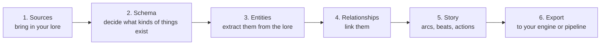
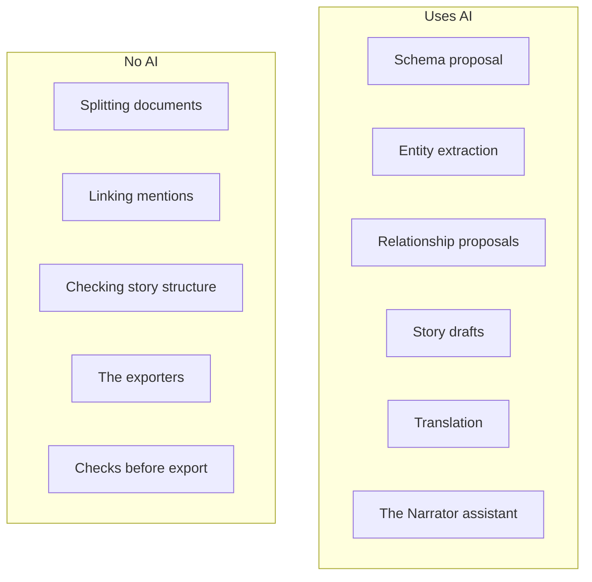
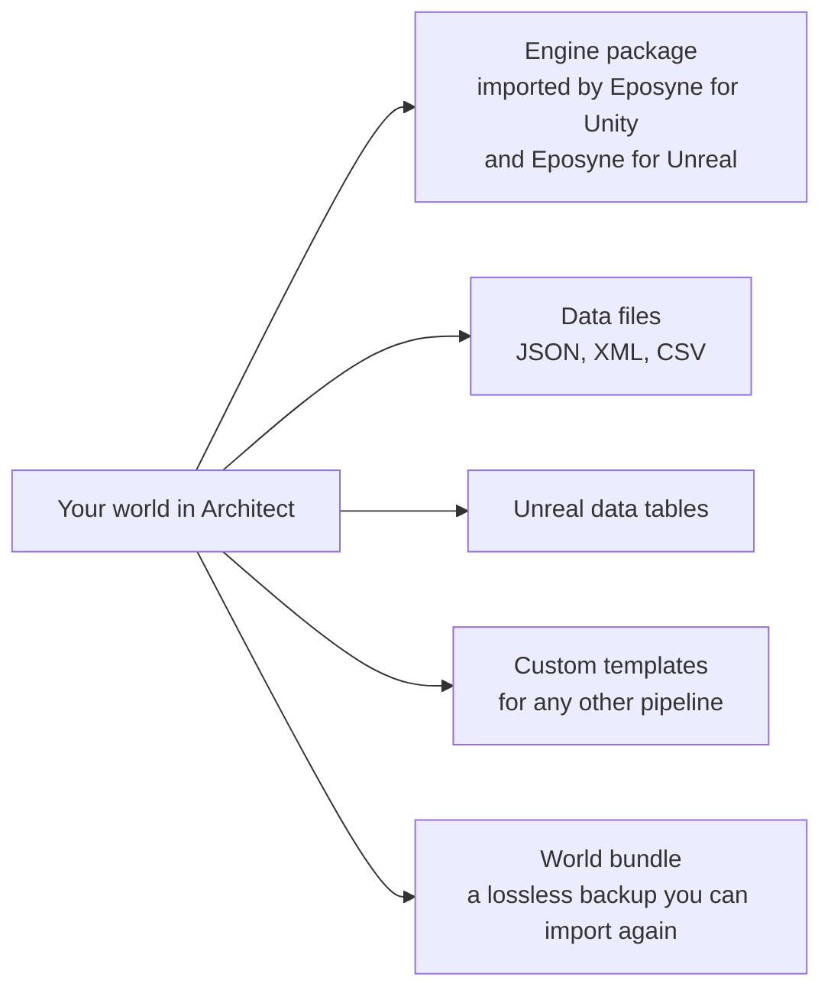

# Eposyne Architect

Architect is a narrative design environment for game teams. You bring the lore you already
have; Architect helps you turn it into a structured world (characters, places, factions,
items, story) and exports it in a form your engine can use. It runs in the browser at
[architect.eposyne.com](https://architect.eposyne.com), has a command line for coding
agents, and is free to start.

[Back to the overview](README.md)

## Today

### The workflow

Work in Architect follows six steps. You can go back to any step at any time.

| Step | What goes in | What Architect does | What you do |
|---|---|---|---|
| **1. Sources** | Plain text, Markdown, Word, PDF, spreadsheets and more; pages from Confluence, Notion, and Google Drive (Pro and up) | Splits each document into pieces that are ready for extraction | Choose what to bring in |
| **2. Schema** | Your sources | AI writes a schema of entity types and their fields from your sources | Edit the schema afterwards, or start from a blank one |
| **3. Entities** | Schema and sources | AI extraction runs in the background and creates the entities directly | Review and edit any entity, or discard a whole extraction run at once |
| **4. Relationships** | Entities | Turns links you add to entity descriptions into relationships, without AI; AI can generate or propose more relationships | Edit the links on a graph |
| **5. Story** | Your world | AI drafts arcs and the actions inside them | Accept or reject each draft; arrange arcs, beats, actions, and branch points on a node canvas |
| **6. Export** | Your world | Produces the output you choose and checks it first | Choose the destination and what to include |

### Where AI helps, and where you decide

AI speeds up the slow parts. It never takes the world out of your hands: everything it
produces can be reviewed, edited, or discarded, and you decide what to export.

Two kinds of AI result, handled differently:

- **Drafts you accept first.** Story arcs and actions, and several proposals (relationship
  updates, generated fields, export preparation), wait for your decision before they change
  the world.
- **Results written directly.** Entity extraction writes entities straight into the world, so
  a large document does not turn into a long approval queue. A whole run can be discarded,
  and history and checkpoints let you go back.

### What comes out

- The **engine package** maps your world onto the types your game uses. Checks run before
  the export, and a report shows what would be exported and what needs attention.
- Exports can include your translations.
- There is no Godot export.

### Around the workflow

- **Wiki.** Every entity has a readable page.
- **Localization.** One base language, translations stored per language, and a language lens
  that shows the whole world in another language without touching the original.
- **Teams.** Studios with writer seats; roles from viewer to owner; separate permissions for
  exporting, spending, connecting sources, translating, and inviting. People can edit
  together, and history and named checkpoints let you go back to any earlier state.
- **Narrator.** An assistant inside the app that operates Architect for you when you ask in
  plain language. It works through the same command line that coding agents use.
- **Command line** (Pro and up). Download it from your profile in Architect and sign in
  through the browser. A coding agent can run your pipeline with it, can preview what an AI
  step will cost before running it, and never gets more authority than the person who set
  it up.
- **Your account.** Your Architect account is your Eposyne account. The engine plugins and
  Director sign in with it.

## In development

These features are built or being built, and are not usable in the web app yet.

- **Gameplay.** Give characters, places, and items actions your engine can run; see the
  state and actions your game actually exposes; bind a ruleset and fill stat blocks from
  the rules you play by; import a rulebook. Tools to prepare and run live sessions from
  your world belong to the same family.
- **World Builder.** Start a world from an idea instead of from documents.
- **Comments and review.** Comments anchored anywhere in the world, and a review step for
  drafts before they become canon.
- **Media.** Uploaded images and video are stored today but do not become lore. Describing
  images with AI is in development. Audio transcription and text recognition in scans are
  not available.
- **Evaluation.** Automated quality checks of a world.
- **Story simulator.** Play through the branches of your story without launching the game.
- **Live preview in the engine.** Send a quest from Architect straight into a running editor,
  instead of exporting and importing.
