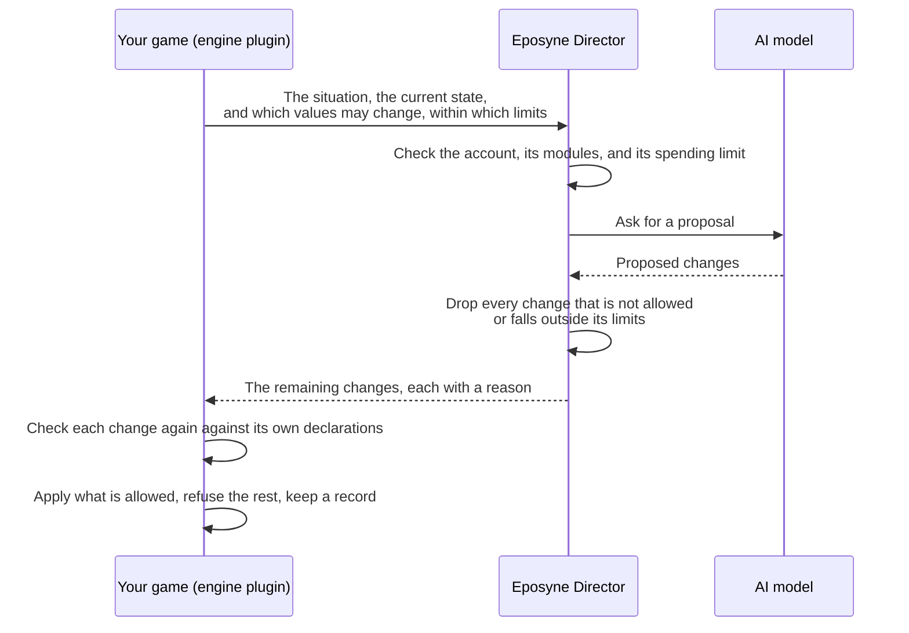
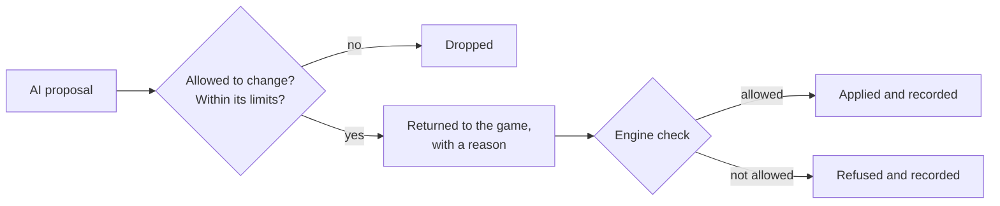

# Eposyne Director

Director is a runtime AI game master, in beta. While the game runs, the game asks Director
what should happen next. Director proposes changes to the game's state, each with a short
reason, and only within the limits the game declared. The game decides what to apply.

[Back to the overview](README.md)

## Today

### Where it runs

Today Director is a **hosted beta**: one service that Eposyne runs, reached over the network
for every decision, which calls cloud AI models. It is for building and testing your game. A
shipped game cannot use it yet.

Director is built to also run on the player's device through a native SDK. That SDK is not
yet available (see [In development](#in-development)).

### One decision, step by step

What the game sends has three parts:

- **The situation**, in plain language: what is happening and what is being decided.
- **The current state**: the values that matter right now, such as a character's mood, a
  faction's standing, or a line of dialogue.
- **What may change**: which of those values Director may change, each with its allowed
  values or its range. A value can also be marked as free text, for dialogue.

Two layers protect the game:

1. **Director's own enforcement.** The AI's answer is treated as untrusted. A fixed set of
   rules, not AI, drops any change to a value that may not change, and any value outside its
   allowed values or range. The rest of the answer still comes back.
2. **The engine's check.** The plugin checks every change again against what the game
   declared, applies only what is allowed, and records what it applied and what it refused.

Director proposes; it never executes anything in your game.

### Signing in and limits

- **Plan.** Using the hosted Director with an Eposyne account, whether signed in or with an
  API key, needs the Pro plan or higher.
- **Account.** Developers sign in with their Eposyne account through the browser, from the
  engine plugin or from Director's web console.
- **API keys.** For everything else, such as a game server, a build script, or an engine
  without a plugin, an account holder creates a Director API key on their Eposyne account.
  A key is shown once and can be revoked at any time. It belongs on a server
  or a developer machine, never in a game build players download or in a web page.
- **Studio keys.** Studios can also use a studio key issued by Eposyne.
- **Paying for decisions.** Each hosted decision is paid from the account's usage credits,
  which you buy on your Eposyne account. A monthly limit on the credits caps what the account spends, and a decision is
  refused, never run unpaid, when the balance runs low.
- **Isolation.** Each account or studio has its own data and its own limits.
- **Models.** You pick from the models the hosted Director offers. Bringing your own model,
  or a local model, is not available.

### Engines and servers

- **Unity and Unreal** connect through the Eposyne plugins (see
  [the engine plugins](engine-plugins.md)).
- **Anything else that can send an HTTPS request**, such as another engine, a game server,
  or a script, calls Director's HTTP interface directly with an API key. There is no Godot
  plugin. Browsers cannot call it directly: a web game calls it from its own backend.

The interface itself (requests, responses, errors, and limits) is documented in the
[Director developer documentation](https://director.eposyne.com/docs/).

### The console

Director has a web console where a signed-in developer sees their usage and spending, which
modules are switched on, and which models they may use. A playground lets you send a test
decision and read the result in plain words.

### What Director does not do

- It does not create new values: it only changes the values the game declared as changeable.
- It does not check types beyond allowed values and ranges.
- It does not read Architect worlds. Architect content reaches the game through the plugin's
  import, and the game sends Director what a decision needs.
- Without the memory module it does not remember on its own: the game passes what happened
  as part of the state it sends.

### Story arcs and memory

Two optional modules, which each account switches on for itself next to its API keys:

- **Story arcs.** Follows what happens in the game and gives Director a sense of where the
  story is going: arcs you authored, and arcs it starts when events fit, including events
  that start without the player asking.
- **Memory.** Lets characters remember what they saw and heard, and what others told them,
  across scenes and sessions. The game can read what a character believes.

Both follow the **event stream**: the game reports what happens as it happens, and Director
only observes it, never treating an event as an instruction. Every AI call these modules make
is paid from usage credits like a decision. Storing events, arcs, and memories is not charged
but has limits per account, and a world the game no longer needs can be deleted.

## In development

- **On-device.** A native SDK that runs Director on the player's device: no network calls
  during play, no player data leaving the game, and no per-token cloud bill at play time.
  Not yet available.
- **Runtime creation.** Creating new characters, factions, or quests while the game runs.
- **Shipped games.** A way for a released game, and its players, to reach Director.
