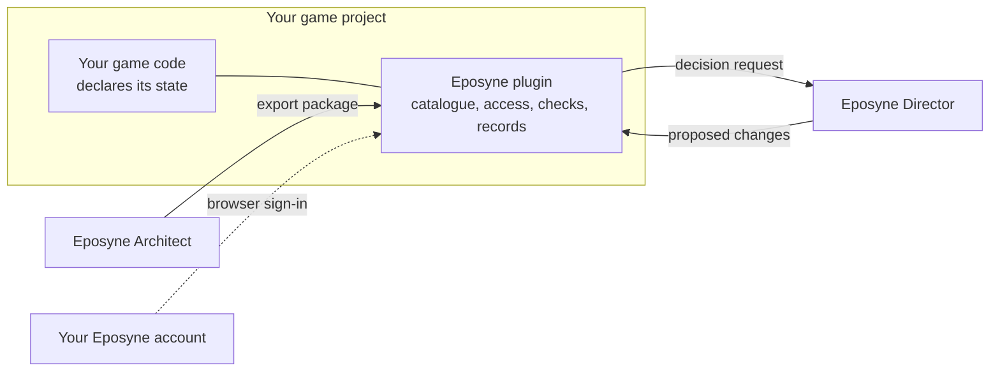
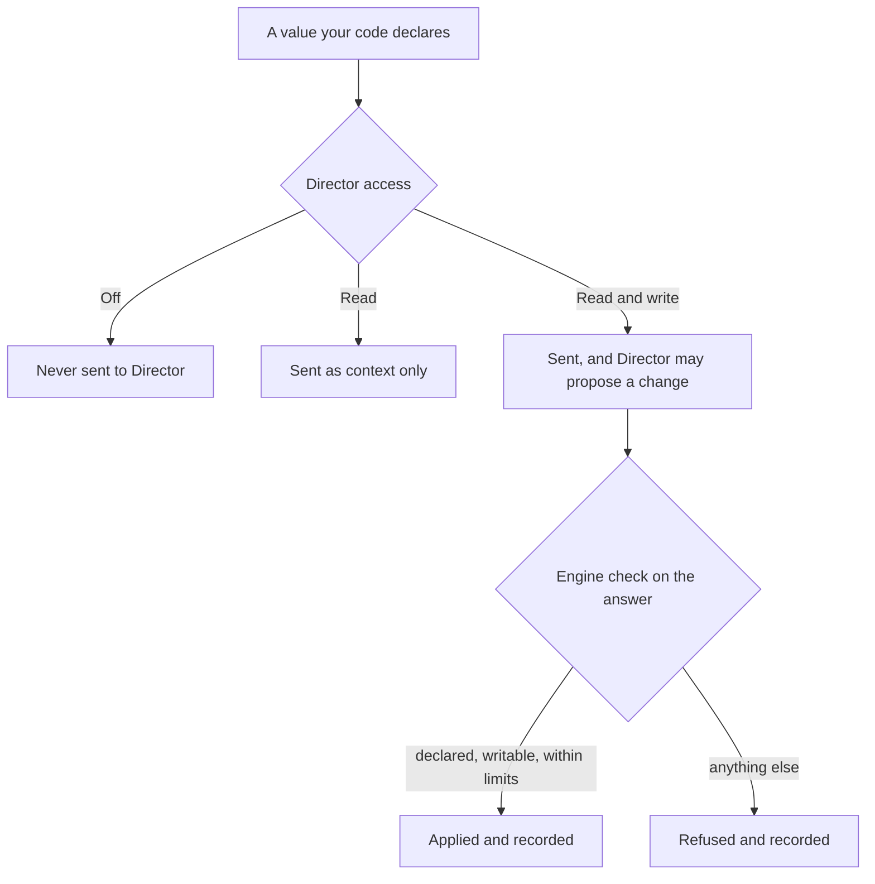

# The engine plugins

Eposyne for Unity and Eposyne for Unreal connect a game project to Architect and Director.
The plugin is the only part of Eposyne that touches the running game, so it has the final
word on anything that changes there.

[Back to the overview](README.md)

## How the pieces connect

## The catalogue: what the game allows

The game's own code declares which parts of its state Eposyne may see. The plugin gathers
those declarations into one catalogue. Each entry has a permanent identity and a readable
name, and **separate access for each product**:

| Access level | What it means |
|---|---|
| Off | The product never sees the value |
| Read | The product sees the value |
| Read and write | The product sees the value and may change it; for Director, that means it may propose a change |

Each value has one level for Architect and one for Director, so a value can be open to
Architect and closed to Director, or the other way round. A value Director may only read is
context for its decision.

## Today

Both plugins, for development and testing:

- **Sign in** with your Eposyne account through the browser, from inside the editor.
- **Import from Architect.** Bring in Architect's engine package; your world becomes data
  in your project.
- **Declare game state** in your code, with separate access for Architect and Director, and
  manage the declarations in the plugin's editor window.
- **Ask Director** for decisions against the hosted beta. The plugin sends only what Director
  may read, checks every proposed change again, applies only what is allowed, and keeps a
  record of what it applied and what it refused.

## In development

- **Operations.** Game actions with parameters, such as giving an item, that Architect's
  story and Director can both trigger through the same safe path in the engine.
- **Events.** The game reports what happens as it happens. Director's story-arc and NPC
  memory modules follow the stream, and Architect's story can react to it.
- **The game's vocabulary in Architect.** The plugin publishes its catalogue to Architect, so
  writers work with the state and actions the game really has.
- **Live preview.** A quest sent from Architect appears in the running editor without an
  export and import.
- **Shipped games.** A way for a released game, and its players, to reach Director.
